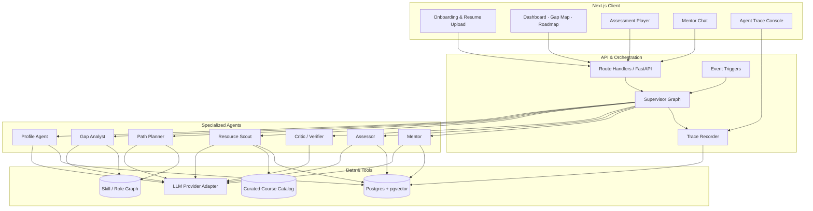
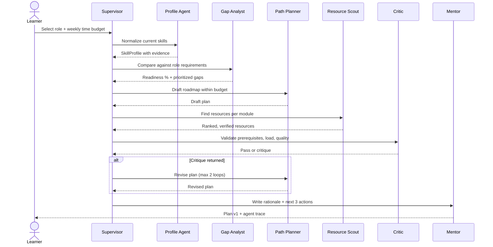

# PromptWars X RTC — Solution Architecture

> **Time-boxed variant:** if the build window is 5 hours with a mandatory live deployment, use [`5H-BUILD.md`](./5H-BUILD.md). It keeps this architecture's deterministic core and Critic loop while removing Postgres, `pgvector`, LangGraph, auth, and file uploads. The document below is the full 36-hour version.

**One-line pitch:** A skill-graph-backed, multi-agent learning copilot that turns any learner's current skills into a personalized, prerequisite-correct roadmap — and visibly re-plans itself when the learner fails an assessment or changes careers.

**Recommendation:** Build **Option B — Orchestrated Agent Graph + Deterministic Skill Engine**. It is the best balance of "real agentic AI", demo reliability, and 36-hour feasibility. Borrow the Critic agent from Option C.

---

## 1. The problem, decoded

The brief asks for six features, but the actual differentiator is **stateful adaptation**. Anyone can prompt an LLM to "make me a learning plan." Judges will look for a system that:

| Requirement | What judges will actually check |
|---|---|
| User profile | Real intake (resume / skills / goals), not a hardcoded form |
| Skill analysis | Normalized skills with evidence and proficiency, not a text blob |
| Career matching | Explicit comparison against a role's required skills and levels |
| Learning recommendations | Real, relevant resources mapped to specific gaps |
| Progress tracking | Assessments that change the plan, not just a progress bar |
| AI mentor | Context-aware guidance grounded in the learner's actual state |
| Agentic AI | Multiple agents with distinct jobs, tools, handoffs, and a visible collaboration trail |
| Adaptability | A failed quiz or a changed goal produces a **new plan version with an explanation** |

**The hard part is not content generation. It is the loop:**

```
profile → gap → plan → learn → assess → adapt → new plan
```

Most hackathon teams build a one-shot generator. Build the loop and show the loop — that is the winning demo.

---

## 2. Three viable solutions

### Option A — Prompt-Chain MVP ("the 12-hour safety net")

```
Browser (JSON/localStorage)
   ↓
Next.js /api/generate-plan
   ↓
Prompt 1: extract skills → Prompt 2: find gaps → Prompt 3: roadmap → Prompt 4: resources
   ↓
Static JSON course catalog
```

One model, four sequential calls, no database, no real orchestration. "Agents" are personas inside prompts.

| | |
|---|---|
| **Build effort** | 1 person, 10–14 hours |
| **Risk** | Low |
| **Agentic credibility** | 2/5 — a pipeline wearing agent costumes |
| **Explainability** | 2/5 — no trace, no evidence |
| **Adaptability** | 2/5 — regenerate everything on change |
| **Demo wow** | 2/5 |
| **Best for** | A solo team, <24 hours, or as the **fallback demo path** behind the real app |

**Verdict:** Ship it only as a safety net. It does not satisfy the explicit multi-agent requirement.

---

### Option B — Orchestrated Agent Graph + Deterministic Skill Engine ★ Recommended

A deterministic skill/role graph does the correctness-critical work (gap math, prerequisites, workload). Specialized LLM agents do the judgment work (parsing, prioritization narrative, resource ranking, mentoring). A supervisor graph coordinates them over a typed shared state, and events trigger re-planning.

```
Next.js UI ── API ── Supervisor (LangGraph / typed state machine)
                        │
        ┌───────────────┼────────────────┬──────────────┐
        ▼               ▼                ▼              ▼
   Profile Agent   Gap Analyst      Path Planner   Resource Scout
                        │                │              │
                        └────────────► Critic ◄─────────┘
                                         │
                              Assessor ──┴── Mentor
                                         │
                              Postgres + pgvector + skill graph
```

| | |
|---|---|
| **Build effort** | 3–4 people, 30–36 hours |
| **Risk** | Medium |
| **Agentic credibility** | 5/5 — distinct agents, tools, handoffs, critique loop, event-driven adaptation |
| **Explainability** | 5/5 — every recommendation traces to a skill, a role requirement, and a catalog item |
| **Adaptability** | 5/5 — plan diffs are a first-class feature |
| **Demo wow** | 5/5 — live "agent war room" plus visible re-planning |
| **Best for** | A team that wants to win and can parallelize |

**Verdict:** Recommended. It directly maps to every line of the brief and is still achievable in a weekend.

---

### Option C — Autonomous Agent Mesh ("the moonshot")

Agents communicate over a blackboard/message bus. A Planner decomposes, a Critic challenges, a Browser agent scrapes live job postings and courses, a Mentor negotiates with the learner. Fully autonomous loops with emergent behavior.

```
Planner ⇄ Critic ⇄ Researcher ⇄ Mentor ⇄ Assessor
        (shared blackboard / message bus)
```

| | |
|---|---|
| **Build effort** | 4+ people, 40–48 hours |
| **Risk** | High — nondeterminism, latency, runaway loops, hard debugging |
| **Agentic credibility** | 5/5 |
| **Explainability** | 3/5 — emergent order is impressive but hard to explain live |
| **Demo wow** | 4/5 when it works, 1/5 when a loop stalls on stage |
| **Best for** | Teams with prior agent-framework experience and a rehearsed fallback |

**Verdict:** Do not build standalone. Add its best idea — a **Critic/Verifier agent** — to Option B.

### Comparison at a glance

| Criterion | A: Prompt Chain | B: Agent Graph ★ | C: Agent Mesh |
|---|---|---|---|
| Time to first working demo | 3h | 10h | 18h |
| Full build | 12h | 36h | 48h+ |
| Meets "multiple collaborating agents" | Weak | Strong | Strong |
| Prerequisite-correct plans | Unreliable | Guaranteed | Usually |
| Handles goal change / failed quiz | Regenerate all | Surgical plan diff | Emergent |
| Live demo reliability | High | High (with replay mode) | Medium/Low |
| Cost per plan | Low | Medium | High |
| Recommended for | Fallback | **Submission** | Stretch |

**Decision rule:** Choose A if you have <24h or one builder. Choose B for a 36–48h team of 3+. Choose C only if agent infrastructure is already your team's comfort zone.

---

## 3. Recommended architecture (Option B)

### 3.1 System diagram



### 3.2 Architecture principles

1. **Deterministic where correctness matters, agentic where judgment matters.** Gap arithmetic and prerequisite ordering are code. Prioritization narrative, resource fit, and mentoring are LLM work.
2. **Contract-first handoffs.** Every agent consumes and produces a typed schema (Zod/Pydantic). No agent parses another agent's prose.
3. **Every agent has tools.** A "profile" that only prompts an LLM is a persona, not an agent. Give each one at least one real tool (DB query, vector search, link checker, rule engine).
4. **Adaptation is an event, not a chat message.** `assessment.graded`, `goal.changed`, `module.completed`, `learner.inactive` fire an orchestrated re-plan workflow.
5. **Show the work.** The agent trace is a product feature, not debugging output. It is how judges verify collaboration.
6. **Demo reliability is an architecture requirement.** Live mode + replay mode + seeded data from day one.

### 3.3 Agent roster

| Agent | Mission | Tools | Output |
|---|---|---|---|
| **Profile Agent** | Parse resume/self-assessment, normalize skills to taxonomy IDs, assign level + confidence | PDF/DOCX parser, embedding matcher, LLM extractor | `SkillProfile` |
| **Gap Analyst** | Compare profile to target role, compute readiness, rank gaps, suggest adjacent roles | Role-skill graph, scoring engine | `GapReport` |
| **Path Planner** | Build a prerequisite-closed, workload-feasible phased roadmap | Topological sort, duration/budget model, course metadata | `DraftPlan` |
| **Resource Scout** | Retrieve and rank 2–3 resources per module, verify links, diversify formats | Hybrid search (pgvector + BM25), link checker, catalog DB | `ModuleResources[]` |
| **Critic / Verifier** | Challenge the plan: prerequisites, weekly load, resource quality, budget | Rule engine + rubric + LLM review | `Review` (pass or structured critique) |
| **Assessor** | Generate module quizzes, grade attempts, update mastery estimates | Question bank, answer keys, LLM rubric judge | `AssessmentResult` |
| **Mentor** | Explain the plan, answer questions, nudge, request re-plans | Learner-state reader, replan tool, resource search, streaming chat | `Message` + optional `PlanChangeRequest` |

The **Critic** is the key collaboration signal: Planner produces, Critic challenges, Planner revises (max 2 loops). That is genuine multi-agent behavior, not a renamed pipeline.

### 3.4 Orchestration flow



**Typed shared state (simplified):**

```json
{
  "learnerId": "usr_priya",
  "targetRoleId": "full-stack-developer",
  "constraints": { "hoursPerWeek": 10, "deadlineWeeks": 12 },
  "skills": [
    { "skillId": "python", "level": 3, "confidence": 0.9, "evidence": ["resume", "project"] },
    { "skillId": "sql", "level": 3, "confidence": 0.8, "evidence": ["resume"] },
    { "skillId": "html", "level": 2, "confidence": 0.7, "evidence": ["self-assessment"] }
  ],
  "gap": {
    "readiness": 0.42,
    "mustHave": [
      { "skillId": "javascript", "required": 4, "current": 0, "priority": 0.95 },
      { "skillId": "react", "required": 3, "current": 0, "priority": 0.88 },
      { "skillId": "nodejs", "required": 3, "current": 0, "priority": 0.84 }
    ],
    "niceToHave": []
  },
  "plan": { "id": "plan_123", "version": 1, "phases": [], "totalHours": 96 },
  "trace": { "runId": "run_456", "handoffs": [], "toolCalls": [] }
}
```

**Orchestration rules:**
- Hard cap: 2 critic revisions, 90 seconds per plan generation, 3 retries per tool call.
- If an agent fails, degrade gracefully: deterministic fallback for gap/plan; template rationale instead of Mentor prose.
- Persist every run in `agent_runs` and stream it to the trace console over SSE.

### 3.5 The deterministic core (your moat)

#### Skill taxonomy and role graph
- ~200–300 skills with aliases and prerequisite edges (`javascript → react`, `python → pandas`, `sql → data-modeling`).
- ~40–60 roles, each with `{skill, requiredLevel (0–5), weight (1–5), mustHave}`.
- Seed from an open taxonomy (ESCO/O*NET subset) plus a hand-curated demo set. **Do not let the LLM invent the taxonomy during the demo.**

#### Readiness and gap scoring

```
readiness = Σ (w_s × min(L_s, R_s)) / Σ (w_s × R_s)

gap_s     = max(0, R_s − L_s)
priority_s = (w_s × gap_s × unlock_s) / effort_s
```

- `L_s` = learner level, `R_s` = required level, `w_s` = role importance, `unlock_s` = downstream skills/modules unlocked, `effort_s` = estimated hours.
- Use priority to order the roadmap; use readiness as the dashboard headline.
- Confidence is displayed separately and triggers an optional verification quiz when it is low.

#### Path planning algorithm
1. Required set = must-have role skills + prerequisite closure.
2. Drop skills already at/above required level with sufficient confidence.
3. Topologically sort by the prerequisite DAG.
4. Pack into phases by `hoursPerWeek`; each module = learn + practice + assess.
5. Reserve ~15–20% buffer; never exceed 110% of the stated weekly budget.
6. Planner writes the narrative; the **ordering comes from code**.
7. Critic validates prerequisites, load, and resource fit; Planner revises if needed.

#### Adaptation rules

| Event | Condition | Action | Agents involved |
|---|---|---|---|
| Assessment failed | score < 60% | Insert remediation module, switch resource modality, schedule re-test in 3 days, cut next week's load by 20% | Assessor → Gap → Planner → Critic → Mentor |
| Assessment borderline | 60–79% | Keep schedule, add targeted practice on weak skill tags | Assessor → Planner → Mentor |
| Assessment strong | ≥ 80% | Advance, unlock stretch project, increase pace slightly | Assessor → Planner → Mentor |
| Goal changed | any | Compute transferable-skill overlap, preserve shared/completed modules, regenerate only the delta, show a plan diff | Gap → Planner → Critic → Mentor |
| Inactivity | 7 days | Mentor nudge; offer a lighter week | Mentor |
| New certification | evidence added | Raise mastery + confidence, re-run gap analysis | Profile → Gap → Planner |

**Goal-change math:** `overlap = Σ weighted min(oldRequired, newRequired) / Σ oldRequired`. Preserve modules whose skills are in the overlap. Show "we kept 60% of your plan" — this is a signature demo moment.

### 3.6 RAG and assessment design

**Course catalog (curated, not scraped live):**
- 120–200 items from freeCodeCamp, MDN, official docs, Kaggle, YouTube playlists, Coursera/edX.
- Fields: title, provider, URL, skills[], level, durationHours, format (video/course/project/docs), cost, rating, lastVerifiedAt.
- Embed description + skill tags into pgvector. Hybrid retrieve (BM25 + cosine), then rerank by level fit, format preference, duration, and quality.
- The LLM writes "why this fits you"; it **never invents a URL**. Validate all links at seed time and show a "verified" badge.

**Assessments:**
- Blueprint per module: 5 MCQs + 1 short answer (+ 1 coding task as a stretch).
- MCQs graded deterministically; short answers graded by rubric (0–3) with an LLM judge.
- Every question is tagged with `skillId` and `level`, so a failed answer maps to a remediation module.
- Mastery update: `L_new = clamp(L_old + 0.3 × (score − expected), 0, 5)`; confidence rises with attempts. BKT/Elo is a post-hackathon upgrade.

### 3.7 Data model

| Table | Purpose | Key fields |
|---|---|---|
| `users` | Auth + role (learner/admin) | id, email, role |
| `learner_profiles` | Learner context | userId, headline, hoursPerWeek, targetRoleId |
| `skills` | Taxonomy | id, name, aliases, parentId, prereqIds |
| `learner_skills` | Current state | learnerId, skillId, level, confidence, evidence |
| `roles` | Career targets | id, title, description, demandScore |
| `role_skills` | Requirements | roleId, skillId, requiredLevel, weight, mustHave |
| `courses` | Catalog | id, title, provider, url, format, durationHours, level, embedding |
| `course_skills` | Course → skill | courseId, skillId, level |
| `learning_paths` | Versioned plans | id, learnerId, roleId, version, status, readinessAtCreation |
| `path_modules` | Roadmap items | pathId, phase, order, skillId, courseId, hours, status |
| `assessments` | Generated quizzes | id, moduleId, blueprint, questionsJson |
| `attempts` | Results | assessmentId, learnerId, score, perSkillJson, createdAt |
| `events` | Adaptation triggers | id, learnerId, type, payload, processedAt |
| `agent_runs` | Trace/observability | id, learnerId, agent, inputJson, outputJson, latencyMs, tokens |
| `mentor_messages` | Chat history | id, learnerId, role, content, createdAt |

Use Postgres + pgvector (Supabase is the fastest path). A single JSONB column for agent payloads keeps the schema small without losing traceability.

### 3.8 API surface

| Method | Path | Purpose |
|---|---|---|
| `POST` | `/api/profile/parse` | Upload resume or paste skills → normalized profile |
| `PUT` | `/api/profile` | Edit skills, levels, constraints, goal |
| `POST` | `/api/plan/generate` | Run the full agent graph for a target role |
| `GET` | `/api/plan/:id` | Fetch plan, modules, resources, version history |
| `POST` | `/api/plan/:id/replan` | Manual mentor-triggered re-plan |
| `POST` | `/api/assessment/:moduleId/generate` | Create a module quiz |
| `POST` | `/api/assessment/:id/submit` | Grade, update mastery, fire adaptation |
| `GET` | `/api/progress` | Readiness, streak, completion, per-skill mastery |
| `POST` | `/api/mentor/chat` | Streaming mentor chat with learner context |
| `GET` | `/api/agents/runs/:runId` | Trace for the Agent Console (SSE or JSON) |
| `GET` | `/api/roles` | Role catalog + requirements for the goal picker |

### 3.9 Tech stack

| Layer | Default | Alternative | Why |
|---|---|---|---|
| Frontend | Next.js (App Router) + TypeScript + Tailwind + shadcn/ui | Vite + React | One deploy, fast UI |
| Charts / graph | Recharts + React Flow | D3 | Readiness ring, skill map, roadmap |
| Orchestration | LangGraph.js (typed state, checkpoints, graph view) | Custom 150-line state machine; OpenAI Agents SDK | Debuggable, demo-friendly |
| Backend | Next.js Route Handlers | FastAPI (if Python-heavy team) | Fewer moving parts |
| Database | Supabase Postgres + pgvector | Neon + Drizzle | Auth, storage, vectors in one |
| LLM | Provider adapter; frontier model for Planner/Critic, fast model for extraction/generation | Gemini / OpenAI / Anthropic / DeepSeek | Cost + latency control |
| Embeddings | `text-embedding-3-small` or local `bge-m3` | — | Cheap, good enough |
| Streaming | Vercel AI SDK | SSE | Mentor chat |
| Observability | Custom `agent_runs` + trace UI | Langfuse / LangSmith | Judge-visible trace |
| Deploy | Vercel + Supabase | Docker Compose for offline demo | Reliability |

**Do not build from scratch:** auth (use Supabase/Auth.js), PDF parsing (`unpdf`/`pdf-parse`), link checking (`fetch` HEAD), or vector search (pgvector).

### 3.10 UI pages

1. **Onboarding** — upload resume / enter skills, pick target role, set hours per week and deadline. Target: under 60 seconds to a plan.
2. **Dashboard** — readiness ring, target role, "next 3 actions", streak, recent agent activity.
3. **Gap Map** — have vs need matrix, prioritized gaps, evidence badges, adjacent-role suggestions.
4. **Roadmap** — phased timeline, modules with learn/practice/assess, resources, plan version and diff.
5. **Assessment** — quiz player with instant per-skill feedback.
6. **Mentor** — streaming chat grounded in the learner's plan and recent results.
7. **Agent Console** — live handoffs, tool calls, latencies, critique loops. This is the judge-facing surface.
8. **Cohort (stretch)** — university/admin view: aggregate skill gaps, at-risk learners, path completion.

---

## 4. The 5-minute demo

**Cast:** Priya, final-year student. Skills: Python 3, SQL 3, HTML 2. Goal: Full Stack Developer. Budget: 10 hours/week.

| Time | Beat | What the audience sees |
|---|---|---|
| 0:00–0:35 | Hook | "Universities know grades, not skills. Priya has three skills and a dream — watch the system find the other nine." |
| 0:35–1:20 | Intake | Upload sample resume. Profile Agent extracts Python, SQL, HTML with confidence and evidence. |
| 1:20–2:20 | Gap + plan | Pick Full Stack Developer. Trace console shows Profile → Gap → Planner → Resource Scout → Critic. Readiness 42%. Roadmap: JS → React → Node → testing/capstone. |
| 2:20–3:10 | Fail forward | Take the JavaScript quiz; miss two questions. Assessor tags weak skills, planner inserts remediation, next week's load drops 20%, Mentor explains the change. Show plan v1 → v2 diff. |
| 3:10–4:00 | Change the dream | Switch goal to Data Analyst. System keeps transferable Python/SQL work, regenerates only the delta, shows "60% of your plan preserved." |
| 4:00–4:40 | Progress | Dashboard: readiness, mastered skills, streak, next actions. |
| 4:40–5:00 | Close | Architecture slide: deterministic skill graph + collaborating agents + event-driven adaptation. |

**Reliability plan:**
- `DEMO_MODE=live|replay`: replay returns cached, pre-recorded agent outputs if the network or model fails.
- Seeded demo accounts for Priya (student), a career-switcher, and a cohort admin.
- Pre-warm the plan for the primary path; run live generation for the adaptation beat.
- Record a backup video the night before.

---

## 5. 36-hour execution plan

### Workstreams (3–4 people)

| Stream | Owner | Deliverables |
|---|---|---|
| **Data & core** | A | Taxonomy, role graph, course seed, gap engine, planner, DB schema |
| **Agents & AI** | B | Supervisor graph, 7 agents, RAG, assessment generation/grading, adaptation events |
| **Frontend** | C | Onboarding, dashboard, gap map, roadmap, assessment UI |
| **Integration & demo** | D (or shared) | Auth, mentor chat, agent trace console, deploy, seed data, rehearsal |

### Timeline

| Hours | Milestone |
|---|---|
| 0–3 | Freeze JSON contracts + DB schema + seed plan; repo skeleton; deploy a hello-world end-to-end |
| 3–10 | Deterministic core working: taxonomy, role graph, gap scoring, planner. Profile parsing live. |
| 10–18 | Agent graph + RAG resources + plan persistence. First full plan generated through the trace UI. |
| 18–26 | Assessments, mastery updates, adaptation events, mentor chat. |
| 26–32 | UI polish, plan diff view, agent console, cohort stretch if on track. |
| 32–34 | Feature freeze. Seed demo accounts. Replay mode. |
| 34–36 | Three full rehearsals, backup recording, pitch deck, submission. |

### Definition of done (demo path)
- [ ] Resume upload → normalized profile in < 20 seconds.
- [ ] Full plan generated in < 30 seconds with a visible agent trace.
- [ ] 100% of plan modules satisfy prerequisites (rule-checked).
- [ ] Every recommended resource has a verified HTTP 200 URL.
- [ ] Failing a quiz produces a plan v2 with a human-readable diff.
- [ ] Changing the goal preserves transferable modules and regenerates the delta.
- [ ] Mentor answers "why am I learning this?" using the learner's actual gap data.
- [ ] Replay mode covers every demo beat.

### Explicit non-goals (protect the deadline)
Real course purchases, full LMS/SCORM, live job-board scraping, proctoring, mobile app, fine-tuning, multi-tenant billing. Put them on the "roadmap" slide instead.

---

## 6. Risks and mitigations

| Risk | Impact | Mitigation |
|---|---|---|
| LLM hallucinates courses or links | Demo credibility | Curated catalog only; RAG-grounded; link validation; "verified" badge |
| Agents loop or stall | Demo failure | Max 2 critic loops; 90s timeout; deterministic fallbacks; replay mode |
| Plan violates prerequisites | Judges notice | Deterministic topological planner; Critic rule engine; unit tests on seed learners |
| API quota / cost | Mid-demo failure | Cheap model for subagents; caching; per-run token cap; local embedding fallback |
| Latency feels slow | Weak UX | Parallelize Resource Scout by module; stream trace and mentor chat; show progress states |
| Integration drift between teammates | Lost hours | Contract-first (Zod/Pydantic) at hour 3; mock fixtures; one end-to-end slice early |
| Resume prompt injection | Security concern | Treat uploads as untrusted data; extraction-only prompts; no tool access from raw text |
| PII exposure | Trust | Minimize storage; redact contact details; delete resumes after parsing; demo data only |
| Scope creep | Unfinished core | Non-goals list; stretch features only after definition-of-done passes |
| "These aren't real agents" | Judging risk | Distinct tools, typed handoffs, critic loop, event log, live trace console |

---

## 7. Stretch goals and post-hackathon path

**If you are ahead of schedule (in order):**
1. **Coding assessments** via a sandbox (Judge0/Piston) for practical exercises.
2. **Cohort dashboard** for universities: aggregate gaps, at-risk learners, curriculum coverage.
3. **Live job-market signal**: scrape/ingest postings, weight role requirements by current demand.
4. **GitHub evidence ingestion**: infer skills from repos and raise confidence.
5. **Spaced repetition** and weekly mentor check-ins via email.
6. **Local-first mode**: Ollama + on-device embeddings for privacy-sensitive universities.
7. **LMS/HRIS integrations** (SCORM/xAPI, Workday) — the enterprise wedge.

**Business framing for the pitch:** start with universities (career services) and bootcamps, expand to enterprise L&D. Charge per active learner; sell cohort analytics to administrators. The moat is the skill graph + outcome data, not the prompts.

---

## 8. Judge alignment cheat sheet

| Judging criterion | Evidence in this design |
|---|---|
| Problem understanding | End-to-end profile → gap → plan → assess → adapt loop, not a one-shot generator |
| Agentic AI | 7 specialized agents, tools, typed handoffs, Planner ↔ Critic loop, event-driven re-planning, live trace |
| Technical depth | Deterministic skill graph + scoring math + prerequisite planner + hybrid RAG + mastery model |
| Working demo | Seeded accounts, replay mode, 5-minute script with failure and goal-change beats |
| UX | < 60s to first plan; visual gap map; versioned roadmap; explainable diffs |
| Impact | Measurable readiness, cohort analytics path, university/enterprise model |
| Feasibility | 36-hour plan, named stack, explicit non-goals |

**The one sentence to repeat:** *"The LLM decides what matters to this learner; the skill graph guarantees the plan is correct; the agents make it adapt."*

---

## Appendix A — Seed data for the demo

**Roles and required levels (0–5):**

| Skill | Full Stack Dev | Data Analyst |
|---|---|---|
| Python | 2 | 3 |
| SQL | 3 | 4 |
| HTML/CSS | 4 | 1 |
| JavaScript | 4 | 1 |
| React | 3 | 0 |
| Node.js | 3 | 0 |
| Git | 3 | 2 |
| REST APIs | 3 | 1 |
| Testing | 2 | 2 |
| Statistics | 0 | 3 |
| Data visualization | 1 | 4 |

**Priya:** Python 3, SQL 3, HTML 2 → Full Stack readiness ≈ 42%, must-have gaps: JavaScript, React, Node.js, Git, testing.
**Goal switch:** Data Analyst preserves Python and SQL (≈ 60% of effort), adds statistics and visualization.

## Appendix B — Contract sketch

```ts
type SkillLevel = 0 | 1 | 2 | 3 | 4 | 5;
type AgentName =
  | "profile" | "gap" | "planner" | "resource"
  | "critic" | "assessor" | "mentor";

interface AgentEnvelope<T> {
  runId: string;
  agent: AgentName;
  input: unknown;
  output: T;
  rationale: string;
  toolCalls: { name: string; args: unknown; result: unknown }[];
  latencyMs: number;
  createdAt: string;
}
```

Every agent boundary uses an envelope like this. It gives you tracing, replay, and a consistent UI for free.

---

*Companion file: `problem_statement.txt` (text extracted from the PromptWars X RTC brief).*
